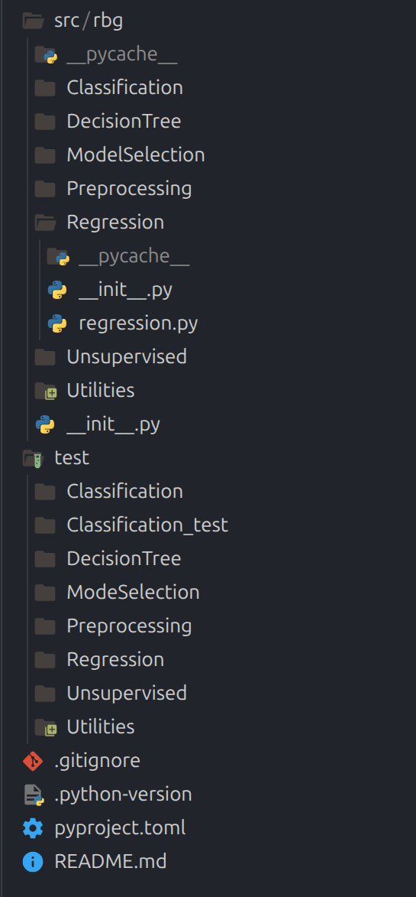
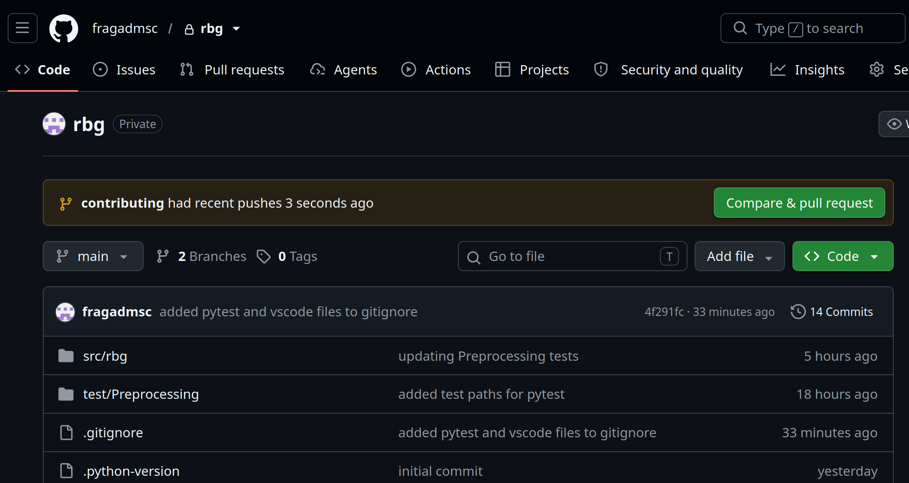
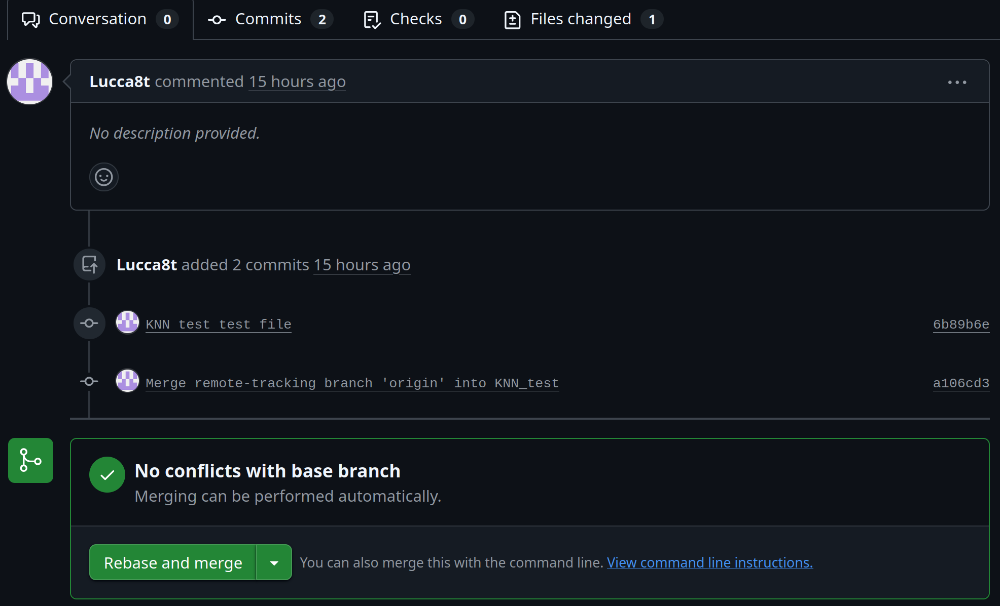

# RBG (Regressão Bem Geral)
#### *a.k.a Rodrigo do Bigode Grosso*

This is the official repository for the machine learning library titled RBG.

This file contains the structure of the library, the workflow with git/github that should be used and the code style guides. This document should be referred to if you have some doubt (it is also a good context base for asking something to AI).

### Table of Contents

- [Quickstart](#quickstart)
- [Project Structure](#library-structure)
  - [Build System](#build-system)
  - [File Structure](#file-structure)
  - [Architecture & public API](#architecture--public-api)
  - [Tests](#tests)
- [Git/GitHub Workflow](#gitgithub-workflow)
  - [Good Practices](#good-practices)
  - [Basic Git Workflow](#basic-git-workflow)
- [Code Style Guide](#code-style-guide)
  - [General Rules](#general-rules)
  - [Docstrings](#docstrings)

### Quickstart

Clone the repository locally with `git clone`, and then run `uv sync` to install the necessary dependencies. You need to have Git installed and authenticated with GitHub (usually via SSH, it may be useful to look up a tutorial). You also need to have `uv` installed.

```bash
git clone https://github.com/fragadmsc/rbg.git
cd rbg #go to the newly cloned repository
uv sync

```

### Project Structure

#### File Structure

The basic file structure is this:



The idea is that each person should usually work separately on some topic (like Unsupervised) and some separated branch. 

#### Architecture & Public API

An API (Application Programming interface) is the interface someone will interact with if they use our library. So the public methods in a class are part of the API, whereas the private helper function in some class is not.

The final user will use the library with `rbg.Topic.specific.method()`. So, if you wanted to fit a linear regression model you would do: `rbg.Regression.Linear.fit(x)`. The specifics on what should be the interface of a specific model are in the `test` folder (we should add a documentation that describes the api sometime). 

#### Build System

The build system used is `uv`. It provides some nice useful functionalities and it is quite fast. You can use it to create a virtual environment `uv venv`, to run your code `uv run main.py` You can refer to the [documentation](https://docs.astral.sh/uv/) if needed. 

#### Tests

The tests will use pytest. We use a TDD (Test Driven Development) approach, so (usually) all of the tests are written before the function or classes, which in turn defines the classes interfaces. To use pytest, just do `uv run pytest` in the folder that you want to test.

### Git/Github workflow

#### Good practices

Each feature should be developed in a separate branch, and no two people should work in the same branch or feature at the same time. The branches are meant to be incremental: don't create only one branch for all of your work. Instead, create a branch for every feature you want to implement, make a pull request to merge it into the main, and then delete it.

#### Basic git workflow

To make some change, you should first update your local main branch to the latest version:

```bash
git switch main
git pull origin main
```

Then create a branch we will follow a name convention: first the type of the change and then the name:

```
feature/<name>
fix/<name>
refactor/<name>
docs/<name>
```

So if we want to create a branch for crating a test for KNN we would create `feature/test-knn`. Fix is for code fixes and bug corrections, refactor is for refactoring the code (like changing an entire class logic to something else) and docs is for adding documentation or comments.

```bash
git switch -c my-new-branch #the switch -c creates a new branch and switchs to it
```

After making some changes (creating files, editing files or deleting files), save them with:

```bash
git add . #the . adds all of the modified files
```

And then commit them with:

```bash
git commit -m "my commit message"
```

When you have the necessary commits, tested the new feature you have implemented, and are ready to merge them into the main branch, you should create a pull request. To do this, make:

```bash
git fetch #this updates your local information about the github repository without modifying your local branch
git merge origin/main #this merges the current version of the main branch into your feature branch
```

Maybe (probably) the `git merge origin/main` will fail eventually, saying that there was a merge conflict. It is normal, and it is not a big problem (it will not completely destroy the repository or something like this, since you are isolated on your branch). 

If you find some, conflicts, you can run `git status`, which will tell which files are conflicting, then you solve these conflicts (by directly editing the files, it may be useful to look up a tutorial) and then:

```bash
git add . 
git commit -m "a message"
```

After solving the conflict (if necessary) and sucessfully merging the origin/main onto your branch, you can push your local branch:

```bash
git push origin my-new-branch
```

You need then to see why the merge conflict is happening, and then decide which changes you want to keep. Usually this means running a `git status` or a `git diff the-branch-you-are-in the-branch-you-want-to-merge` and then checking the differences. It might be useful looking up a tutorial when this happens or asking AI. 

After doing this, you can open github, and an option to pull request will appear:



This will show that your branch is now on github, and you can click `Compare e pull request` and then click `Create pull request`. This will create a pull request. A pull request is like asking for permission to put your new feature into the main branch. Someone will revise your code, and then choose to accept or reject your pull request.

After someone revises your pull request and merge it into the main branch, you can safely delete both the local and the github branch:

```bash
git push origin --delete my-new-branch
git switch main
git branch -d my-new-branch
```

You should not approve or merge your own pull requests. Every PR should be reviewed and approved by at least one other team member.

Also, when accepting pull request, we will always use the rebase option for merging on GitHub (this keeps the commit history clean):



### Code Style Guide

#### General rules

The code should follow general good practices for python code. Try to make the code pythonic, always use type annotations, make a self-explanatory code, this is, make a code that you can infer the objective of the code just from looking at it, and avoid obvious comments, while using comments when necessary on more complex steps of the code.

#### Docstrings

For the docstrings, we will follow the [Google style](https://google.github.io/styleguide/pyguide.html#s3.8-comments-and-docstrings). We will also refer to this document when we are in doubt of what is the best way to write something (it is a big and boring document, there is absolutely no need to read it all, just be aware of using good practices and referring to it when necessary).
